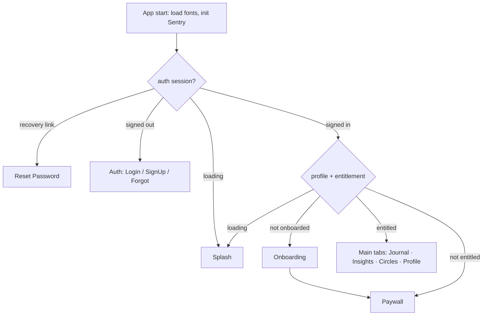

# LYSM

A private mood‑journaling & emotional‑wellness app with trusted "circles": daily
mood + journal entries, AI insight summaries, streak analytics, selective sharing
with reactions, a native home‑screen widget, push notifications, and a
subscription gate.

Built with **Expo (SDK 56) + React Native + TypeScript** on **Supabase**.

> **Status:** All 6 phases feature-complete and validated (typecheck ✅, lint ✅,
> tests ✅, metro bundle ✅). Remaining work is infrastructure + native builds you run
> (Supabase project, EAS, App Store/Play in-app purchases, push creds, widget native targets) — see
> [Definition of done](#definition-of-done). See [Roadmap](#roadmap).

---

## Tech stack

| Concern            | Choice                                                                            |
| ------------------ | --------------------------------------------------------------------------------- |
| App                | Expo SDK 56 (prebuild + Dev Client + EAS), React Native 0.85, React 19, TS strict |
| Navigation         | React Navigation (native stack + bottom tabs)                                     |
| Server / DB / Auth | Supabase (Postgres, Auth, Storage, Edge Functions, Realtime, Cron)                |
| Data fetching      | TanStack Query · Client state: Zustand                                            |
| Forms              | React Hook Form + Zod                                                             |
| Styling            | NativeWind, driven entirely by design tokens (`src/theme/tokens.cjs`)             |
| LLM (server only)  | OpenRouter (Edge Function)                                                        |
| Email              | Resend (Edge Function)                                                            |
| Push               | Expo push service (Expo tokens), fanned out from an Edge Function                 |
| Payments           | App Store / Google Play in-app purchases (server receipt validation) + app-managed trial |
| Observability      | Sentry + structured logging                                                       |
| Tests / CI         | Jest + RNTL, GitHub Actions                                                       |

## Prerequisites

- Node ≥ 20, npm
- A Supabase project (or the Supabase CLI for local dev)
- For native builds: Xcode (iOS) / Android Studio, and an Expo/EAS account

## Getting started

```bash
npm install

# 1) Configure client env (non-secret values only)
cp .env.example .env
#   set EXPO_PUBLIC_SUPABASE_URL and EXPO_PUBLIC_SUPABASE_ANON_KEY

# 2) Apply the database schema to a NEW Supabase project
#    (or `supabase start` for a local stack, then `supabase db reset`)
#    Never `db push` to the production project: see DEPLOY.md.
supabase link --project-ref <your-ref>
supabase db push

# 3) Generate types from the live DB (optional; a hand-authored copy is committed)
supabase gen types typescript --project-id <your-ref> --schema public > src/types/database.ts

# 4) Run (this app uses custom native code, so use a Dev Client build)
npm run prebuild        # generates ios/ + android/ from app.config.ts
npm run ios             # or: npm run android
```

> The app uses native modules (secure store, notifications, future widget), so it
> runs in a **Dev Client**, not Expo Go. `npm run start` launches the dev server in
> dev‑client mode.

### Scripts

| Script                      | Purpose                              |
| --------------------------- | ------------------------------------ |
| `npm run start`             | Dev server (Dev Client)              |
| `npm run ios` / `android`   | Build & run native app               |
| `npm run prebuild[:clean]`  | Generate native projects from config |
| `npm run typecheck`         | `tsc --noEmit`                       |
| `npm run lint` / `lint:fix` | ESLint                               |
| `npm run format`            | Prettier                             |
| `npm test` / `test:ci`      | Jest                                 |

## Project structure

```
src/
  features/        one self-contained folder per feature (auth, journal, circles, ...)
                   features talk to each other ONLY via their index.ts
  components/      shared, token-driven UI primitives (Text, Button, Card, ...)
  theme/           design tokens (single source of truth) + moods + fonts
  lib/             supabase client, query client, env, logger, sentry, secure storage
  navigation/      typed navigators + gating + deep-link config
  store/           Zustand (true client state only)
  types/           generated/typed DB schema
supabase/
  migrations/      versioned SQL: schema + RLS + indexes + seeds
  config.toml      local/dev config (auth deep-link redirects, pooler, ...)
```

## Architecture

### Navigation & the subscription gate



The gate is **hard** after onboarding (confirmed with the client). Entitlement is
read from the `subscriptions` table, which is written **only** by the service role
(the app-managed trial RPC, and a future store receipt-validation Edge Function) —
never trusted from the client. A `__DEV__`‑only "continue without subscribing" button
exists on the paywall so the main app is reachable while in-app purchases are pending
store setup; it is inert in production.

### Data & security

- **All client access uses the anon key**; Row‑Level Security enforces that users
  read/write only their own rows. Every table has RLS enabled.
- **Privileged work never runs on the client.** LLM (OpenRouter), email (Resend),
  store receipt validation, push send, and fan‑out run in Supabase Edge Functions with
  the service role. No service‑role key or third‑party secret is ever bundled.
- **Sessions** persist in encrypted SecureStore (Keychain/Keystore), chunked to get
  around the 2 KB value limit (`src/lib/secureStorage.ts`).
- **Scale:** every list is designed for keyset pagination; hot paths are indexed;
  fan‑out and AI summaries run async; the schema is partition‑ready on
  `journal_entries.created_at`.

### Design system

The entire app renders from `src/theme/tokens.cjs` (consumed by both NativeWind and
the typed theme) — **no hard‑coded colors, fonts, or spacing.** Serif (Playfair
Display) for headings/journal text, sans (Inter) for UI. See
[`design_and_spec/`](design_and_spec/) for the client design + master specs and
`docs`/memory for which tokens were invented to fill gaps (pending sign‑off).

## Environments & releases

`app.config.ts` is variant‑aware via `APP_VARIANT` (`development` | `staging` |
`production`), each with its own bundle id + deep‑link scheme. `eas.json` defines the
matching EAS Build profiles. Use separate Supabase projects + store product ids per
environment; secrets live in EAS/Supabase, never in the repo.

## Testing & CI

`npm test` runs Jest (jest‑expo). GitHub Actions (`.github/workflows/ci.yml`) runs
typecheck → lint → test on every PR and push to `main`.

## Roadmap

1. **Foundation** ✅ — scaffold, design tokens, schema + RLS, auth, navigation, CI.
2. **Core journaling** ✅ — profile/edit, daily mood (incl. `frustrated`), crisis
   detection, insights/streaks, week/month/year breakdown, AI summaries (Edge Function).
3. **Circles & sharing** ✅ — public/private circles, invites (in-app + email + code),
   join requests, sanitized sharing, reactions.
4. **Notifications & widget** ✅ — push (Expo push service) registration + prefs +
   `send-push` fan-out; daily check-in + day-4 trial local reminders; widget app-side
   + data sync (native target builds on EAS).
5. **Subscriptions** ✅ — App Store / Google Play in-app purchases (expo-iap,
   `src/features/iap`), each checked server-side by the `validate-purchase` Edge
   Function; the stores' 5-day free trial on Annual, with the app-managed trial as the
   fallback until the store products exist; entitlement in `subscriptions`. Real
   purchases pending store setup (see `src/features/iap/README.md`).
6. **Help/FAQ + feedback, permissions, polish** ✅ — searchable FAQ, feedback,
   global toasts; store prep below. (Per-person visibility and blocking were removed
   2026-09-29: everyone in a circle sees everything its members share there.)

## Definition of done

| Build-prompt requirement | Status |
| --- | --- |
| All §9 features end-to-end | ✅ app-side (push delivery + widget UI verify on an EAS build) |
| Permission settings genuinely gate data | ✅ RLS + sanitized RPCs (circle membership is the gate) |
| AI summaries · forgot-password · share toggle · notifications · mood breakdown | ✅ |
| RLS on every table; no privileged secret on client; server-only entitlement writes | ✅ |
| Keyset pagination · indexing · async fan-out · rate limiting | ✅ |
| Crisis detection with tappable, region-aware hotline | ✅ (US 988 seed) |
| Every screen token-driven; no hard-coded styles | ✅ |
| CI green; README complete | ✅ |

### To go live (your infrastructure)

1. Supabase: apply migrations, deploy functions and set secrets as described in
   [DEPLOY.md](DEPLOY.md) (production: migrations through the Management API, never
   `db push`), plus [.env.example](.env.example) + [functions/README](supabase/functions/README.md).
2. EAS: `eas init`, set `EAS_PROJECT_ID`, build a dev client, then store builds.
3. In-app purchases: create the two subscriptions in App Store Connect / Play Console
   with the ids in `src/features/iap/products.ts` (DEPLOY.md, "In-app purchases"), then
   set the `validate-purchase` secrets (`APPLE_IAP_*`, `GOOGLE_PLAY_SERVICE_ACCOUNT`; see
   `src/features/iap/README.md`).
4. Push (Expo): Android — upload an FCM v1 service account to EAS (`eas credentials`)
   + add `google-services.json`; iOS — APNs is auto-managed by EAS; verify delivery
   on a device build. No FCM/APNs keys on the server.
5. Widget: the iOS target (`targets/widget`) and the Android widget plugin are built by
   EAS; check it on a device build (see [modules/widget](modules/widget/README.md)).
6. Replace placeholder icons/splash; confirm crisis hotline regions.

## Notes & decisions

- **Reanimated/worklets** are pinned to Expo SDK 56's expected versions (4.3.1 /
  0.8.3) via `overrides`; Reanimated is required transitively by NativeWind.
- **Crisis keyword data is US‑centric placeholder** (988) pending the client's
  confirmation of regions/numbers — see `supabase/migrations/*_crisis_*`.
- **Pending client confirmations** (build spec §15): OpenRouter model + LLM budget,
  crisis regions, reactions emoji set, final pricing. The design spec is a written
  audit (no comps); invented tokens (notably the mood palette) await sign‑off.
